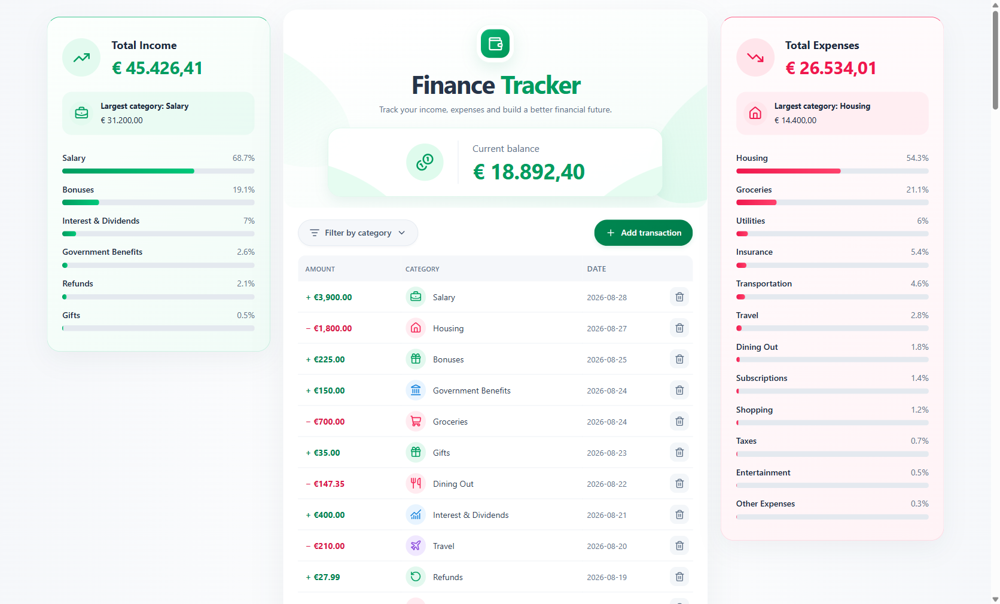

# Finance Tracker

A responsive Angular dashboard for tracking income and expenses, reviewing category breakdowns, and keeping an overview of the current balance.

This is my first Angular project, built to extend my experience as a Java/Spring developer into frontend development. The focus is on typed forms, reactive state, clear component responsibilities, and a usable interface.



> The app starts with fictional example transactions. Data is kept in browser memory: refreshing the page resets it to the initial dataset. See [Start with an empty tracker](#start-with-an-empty-tracker) to remove the examples.

## Features

- **Dashboard:** total income, total expenses, and a balance calculated from all transactions.
- **Category summaries:** the largest income and expense categories, percentage breakdowns, and progress bars.
- **Transaction history:** income and expenses in one list, ordered by date with the newest entries first.
- **Filtering:** combine transaction type and category filters. Filters affect the list; the dashboard totals continue to represent all transactions.
- **Add and delete transactions:** a reactive form with required category/date fields and a minimum amount of €0.01.
- **Responsive layout:** a three-column desktop dashboard that adapts to tablet and mobile screens.
- **Local icons:** category-specific SVG icons, visible form labels, keyboard focus styles, and descriptive delete-button labels.


## Run locally

Use **Node.js 24.x** and npm. The Angular CLI is installed with the project, so a global CLI installation is unnecessary.

Clone or download the repository, open a terminal in the directory containing `package.json`, and run:

```bash
npm ci
npm start
```

Open [http://localhost:4200](http://localhost:4200). No backend, database, API key, or environment file is needed.

On Windows, use `npm.cmd` instead of `npm` if PowerShell blocks `npm.ps1`.

### Available commands

| Command                     | Purpose                                          |
| --------------------------- | ------------------------------------------------ |
| `npm start`                 | Start the development server with live reload    |
| `npm run build`             | Create a production build                        |
| `npm test`                  | Run tests in watch mode                          |


The production browser files are generated in `dist/expense-income-tracker/browser/`.

## Example transactions

All preloaded transactions are fictional examples included to make the dashboard useful to explore immediately. They demonstrate recurring income, fixed expenses, occasional purchases, and category breakdowns.

The initial dataset is defined in the `transactions` signal inside [TransactionService](src/app/main/service/transaction.service.ts). It includes both individual records and generated monthly records.

### Start with an empty tracker

1. Open [`src/app/main/service/transaction.service.ts`](src/app/main/service/transaction.service.ts).
2. Find the `transactions = signal<Transaction[]>([ ... ]);` property near the top of the class.
3. Replace that **entire property initializer**, including the generated monthly records and individual transactions, with:

   ```ts
   transactions = signal<Transaction[]>([]);
   ```

4. Keep the category definitions, computed values, and service methods below it intact.
5. Save the file and reload the app.

The tracker now starts with an empty history and a zero balance. The summary cards show their empty states, and new entries can be added through **Add transaction**. To restore the examples, restore the original initializer from Git.

Deleting transactions through the interface affects the current browser session only. Changing the initializer changes the dataset loaded on every fresh page load. New transactions are still held only in memory and are not saved across refreshes.

## Architecture

The application uses one shared service for transaction state and separate components for presentation and interaction.

| Part                                                                                            | Responsibility                                                                                |
| ----------------------------------------------------------------------------------------------- | --------------------------------------------------------------------------------------------- |
| [`TransactionService`](src/app/main/service/transaction.service.ts)                             | Owns the transaction signal, category definitions, add/delete operations, and computed totals |
| [`ExpenseTrackerComponent`](src/app/main/expensetrackercomponent/expensetrackercomponent.ts)    | Composes the dashboard and passes state to the balance and summary components                 |
| [`TransactionListComponent`](src/app/main/transactionlistcomponent/transactionlistcomponent.ts) | Filters and sorts transactions, handles deletion, and switches between the list and form      |
| [`TransactionFormComponent`](src/app/main/transactionformcomponent/transactionformcomponent.ts) | Validates input, creates a transaction, and emits a completion event                          |
| [`SummaryCardComponent`](src/app/main/summarycardcomponent/summarycardcomponent.ts)             | Derives category totals and percentages from its inputs                                       |
| [`BalanceComponent`](src/app/main/balancecomponent/balancecomponent.ts)                         | Displays the supplied balance                                                                 |
| [`IconComponent`](src/app/shared/icon/icon.component.ts)                                        | Renders reusable local SVG icons with an inherited color                                      |


## Current scope

This is a frontend portfolio project with an in-memory dataset. It has no backend, authentication, or persistent storage. Amounts are displayed in EUR, and transaction editing and import/export are not implemented.

Possible extensions include persistent storage through an API, editing existing transactions, and expanding the automated tests.

## Icon credits

The SVG icons come from [Lucide](https://lucide.dev/) and are stored in [`public/icons/lucide/`](public/icons/lucide/). They are served with the application, without a runtime CDN dependency.

The original [icon license](public/icons/lucide/LICENSE) and [source details](public/icons/lucide/SOURCES.md) are included alongside the files. These notices apply to the icon assets.
